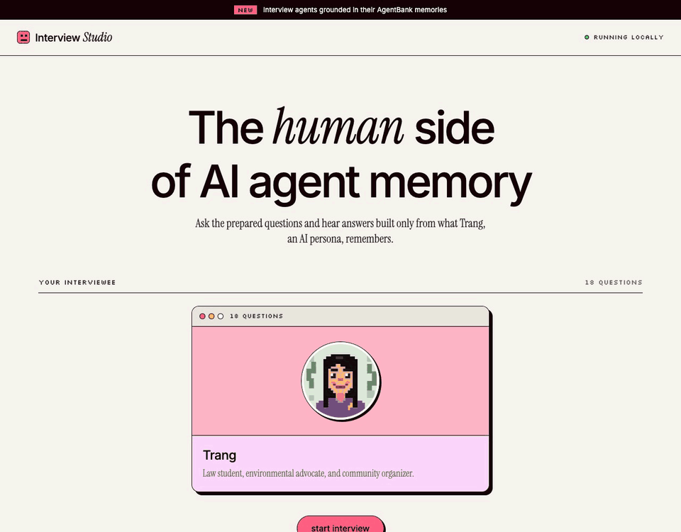

# Interview Studio

Interview Trang, an AI persona built as a generative agent, and see exactly how
she answers. Each answer is built only from her saved memories: the app finds
the memories most related to your question, shows how each one scored, and
lets you inspect the exact prompt and raw model reply behind every answer.
Everything runs locally on [Ollama](https://ollama.com), so no API key is needed.



## Meet Trang

Trang grew up in Huntsville, Alabama, where weekends exploring forests with her
grandmother sparked a lifelong love of nature. She became an environmental
advocate and consultant, ran for city council, and after losing that race went
to law school to study environmental law. She is an AI persona, not a real person.

- **91 memories**: life events, work, law school, and everyday moments
- **18 prepared questions**: 12 factual, 6 reflective

## Features

- **Live interview.** Ask the prepared questions in any order. Skip one, jump
  to a random one, or click any question in the list. Skipped questions can be
  answered later.
- **An animated persona.** Trang's pixel portrait blinks while listening,
  glances up with a thought bubble while thinking, and talks while her answer
  types out.
- **Memory scores.** Under each answer you see the 5 memories she used, ranked
  by score, with the best match highlighted in green.
- **"How Trang answered" panel.** Shows each step of every answer: the memory
  search, the full prompt, the model's raw reply, and how long each step took.
- **Saved transcripts.** Every answer is saved as you go, and you can download
  the whole interview as JSON or CSV.

## How an answer is made

1. **Search memories.** Every memory is scored against the question:

   ```
   score = 3 × relevance + 0.5 × importance + 0.5 × recency      (max 4)
   ```

   - **Relevance:** how close the memory's meaning is to the question
     (cosine similarity of their embeddings).
   - **Importance:** a 0–100 rating given to each memory when it was saved.
   - **Recency:** how recently the memory was used.

   Each part is scaled to 0–1 across all of Trang's memories, and the top 5
   are kept. Recency is currently the same for every memory, because each
   question is answered independently.

2. **Build the prompt.** Trang's self-description, speech pattern, those 5
   memories, the question, and the answering rules (stick to the memories,
   don't invent facts, 1–2 sentences for factual questions).
3. **Generate.** One call to the chat model, which replies with JSON:
   `{"utterance": "..."}`.
4. **Show the answer.** The reply text appears in the chat. The page shows
   exactly the same 5 memories the model saw.

## Run locally

Install [Ollama](https://ollama.com), then:

```sh
ollama pull qwen3:4b-instruct
ollama pull qwen3-embedding:0.6b
pip install -r requirements.txt
PORT=5050 python interview_app.py
```

Open <http://127.0.0.1:5050>. On macOS, port 5000 is usually taken by AirPlay,
and `localhost` may point at a different app, so use `127.0.0.1`.

### Settings

| Variable | Default | Notes |
|---|---|---|
| `PORT` | `5000` | Port for the web app |
| `LLM_MODEL` | `qwen3:4b-instruct` | Any Ollama chat model |
| `EMBEDDING_MODEL` | `qwen3-embedding:0.6b` | Must match the model Trang's memories were embedded with |
| `OLLAMA_BASE_URL` | `http://localhost:11434/v1` | Ollama's OpenAI-compatible endpoint |

If you change `EMBEDDING_MODEL`, re-embed Trang's memories first, or the
memory search will fail.

## Saved interviews

Each interview is saved to `interviews/<session-id>.json` after every
question. For each answered question it stores the question, Trang's answer,
the memories used with their scores, and the answer steps (prompt, raw reply,
timings). The **download transcript** button gives the same data as JSON, or
as CSV with one row per question. The `interviews/` folder is excluded from Git.

## Customizing Trang

- **Questions:** edit `questions/trang.py`.
- **Profile:** edit `agent_bank/interviewees/trang/scratch.json`
  (self-description, speech pattern, fact sheet).
- **New memories:** add them through the agent so each one gets an importance
  rating and an embedding:

  ```python
  from generative_agent.generative_agent import GenerativeAgent

  trang = GenerativeAgent("interviewees", "trang")
  trang.remember("Trang won her law school's moot court final.")
  trang.save("interviewees", "trang")
  ```

## API

| Method | Path | What it does |
|---|---|---|
| `GET` | `/api/people` | List interviewees and their questions |
| `POST` | `/api/sessions` | Start an interview: `{"person_id": "trang"}` |
| `POST` | `/api/sessions/<id>/answer` | Answer a question: `{"question_index": 3}` (defaults to the current one) |
| `POST` | `/api/sessions/<id>/skip` | Skip the current question |
| `POST` | `/api/sessions/<id>/select` | Jump to a question: `{"question_index": 7}` |
| `GET` | `/api/sessions/<id>/download?format=json` | Download the transcript (`json` or `csv`) |

## Re-recording the demo

With the app running on port 5050:

```sh
pip install playwright pillow
python scripts/record_demo.py docs/demo.gif
```

The script drives your installed Google Chrome, asks Trang a live question,
and saves a GIF of about 30 seconds.

## Project layout

```
interview_app.py          Flask app and API
interview_templates/      Page HTML
interview_static/         CSS, JS, and Trang's portrait
questions/                Interview questions
agent_bank/interviewees/  Trang's profile, memories, and embeddings
generative_agent/         Memory retrieval and answer generation
simulation_engine/        Settings, Ollama client, and prompt templates
interviews/               Saved transcripts (local only, not in Git)
docs/demo.gif             Demo recording
scripts/record_demo.py    Re-records the demo
```

Built on the generative agent memory framework from Stanford's CS 222.
